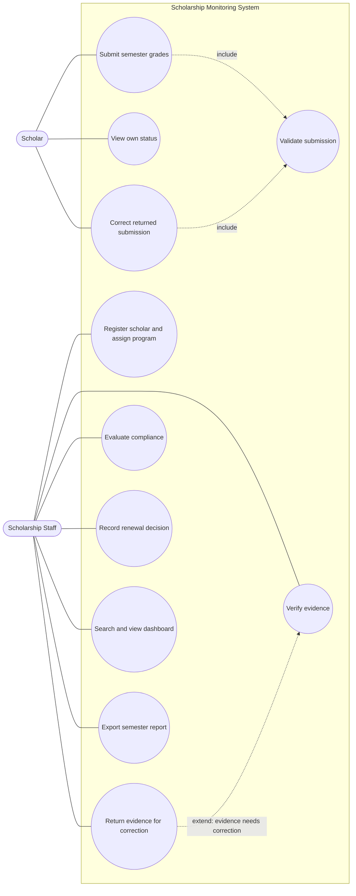
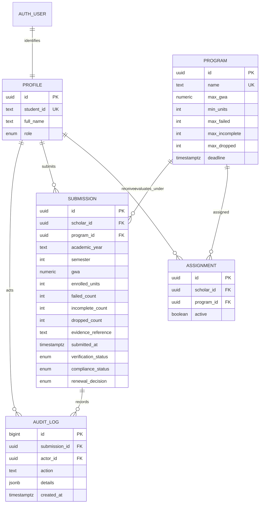

# Systems Analysis and Design — Section B

## A1. Investigation and planning

**Problem statement.** Scholarship Office staff reconcile grade spreadsheets, email evidence, and paper records manually. Duplicate semester rows, evidence that has not been checked, deadline uncertainty, and inconsistent use of program thresholds delay decisions. Scholars lack a dependable view of receipt, verification, and correction status.

| ID | Cause | Effect |
|---|---|---|
| P1 | Records are copied among spreadsheets and email | Duplicate or missing semester entries |
| P2 | Verification is tracked informally | Unverified evidence may be used in a decision |
| P3 | Thresholds are not applied from one policy source | Similar cases may receive different outcomes |
| P4 | No shared status or deadline view exists | Scholars miss corrections and staff miss deadlines |

**Scope:** authenticated Scholar and Scholarship Staff workflows; profiles and program assignments; semester grade-summary submission with document reference; duplicate and value validation; staff evidence verification/return; program-based compliance with reasons; explicit renewal decision and notes; dashboard, search, filters, history, and synthetic tests.

**Exclusions:** changing official Registrar grades, paying awards, live Registrar integration, SMS, machine learning, appeal workflow, exception processing, and production identity provisioning.

| Development task | Output |
|---|---|
| DT1 Model tables, constraints, and roles | Schema and access rules |
| DT2 Build submission and correction workflow | Validated semester record UI |
| DT3 Build verification, evaluation, and decision path | Staff review and history |
| DT4 Build dashboard and exercise test records | Searchable status summary and test evidence |

| Risk | Response |
|---|---|
| R1 Incorrect access policy exposes another scholar's record | Default deny, enforce ownership in RLS, test with separate users |
| R2 Policy/deadline interpretation drifts between UI and database | Persist program thresholds, use inclusive comparisons and Asia/Manila timestamp, review boundary cases |

## A2. Stakeholders and elicitation

| Stakeholder | Interest | Actual system actor? |
|---|---|---|
| Scholar | Submit summaries, see own status, correct returned records | Yes: Scholar |
| Scholarship Staff | Verify, evaluate, decide and report | Yes: Scholarship Staff |
| Registrar | Custodian of official grades | No; external source, not an actor in this MVP |
| Scholarship Office management | Oversight of workload and outcomes | No direct use case actor in MVP; consumes staff reports |

**Open questions:** 1. What evidence makes a grade document verifiable, and what should staff record when it is unclear? 2. How should the office communicate the exact submission deadline and Manila time zone? 3. Which compliance results and reasons must a scholar be able to see? 4. What policy exceptions can arise, and who authorizes them? 5. Which student fields should staff search, and which fields must remain hidden from scholars? 6. Which semester and program reports help staff plan renewal reviews?

## A3. Requirements and rules

### Functional requirements

| ID | Testable requirement |
|---|---|
| FR01 | The system shall authenticate users and assign Scholar or Scholarship Staff role. |
| FR02 | A scholar shall read only their own submissions; staff shall read all assigned synthetic records. |
| FR03 | Staff shall register a scholar, assign a persisted Excellence or Access program, and maintain its thresholds. |
| FR04 | A scholar shall submit academic year, semester, GWA, units, failed, incomplete, dropped counts, and evidence reference. |
| FR05 | The system shall reject GWA outside 1.00–5.00, negative/noninteger counts, missing evidence, and duplicate scholar/year/semester. |
| FR06 | Staff shall mark evidence Verified or Returned with a reason; returned records shall be correctable and resubmitted to Pending. |
| FR07 | The system shall evaluate only verified submissions using the assigned program's persisted thresholds and show each result/reason. |
| FR08 | Staff shall record Approved or Held and a note; approval shall require Compliant evaluation. |
| FR09 | Staff shall view semester totals and filter/search by name, student ID, program, and compliance. |
| FR10 | The system shall preserve submissions after refresh and log verification, evaluation, correction, and decision actor/time. |

### Non-functional requirements

| ID | Requirement |
|---|---|
| NFR01 | 100% of scholar reads/writes shall be constrained by authenticated identity at the database boundary. |
| NFR02 | For 500 synthetic records, dashboard filtering shall complete within 2 seconds on a standard campus laptop. |
| NFR03 | At 360px viewport width, core submission and status workflows shall remain usable without horizontal page scrolling. |
| NFR04 | Persisted timestamps shall be timezone-aware; deadline comparisons shall use Asia/Manila, with the exact deadline treated as on time. |

### Business rules

| ID | Rule |
|---|---|
| BR01 | Excellence Scholar: GWA ≤2.00, units ≥18, failed=0, incomplete=0, dropped=0. |
| BR02 | Access Scholar: GWA ≤2.50, units ≥15, failed=0, incomplete=0, dropped≤1. |
| BR03 | One submission per scholar, academic year, and semester. GWA is inclusive 1.00–5.00; counts and units are nonnegative integers. |
| BR04 | Grade document reference must be present and verified before evaluation; returned correction resets verification to Pending. |
| BR05 | Deadline is 2026-11-06 17:00 Asia/Manila; exact boundary is on time, later is deficient. |
| BR06 | Only staff decide renewal. Staff may hold any evaluated record; approval requires Compliant. Compliance flags never automatically change award status. |

## A4. UML use-case model

The include links represent mandatory shared input validation during both initial submission and correction. Returning evidence is conditional and extends verification at the point where the evidence is insufficient; it is not a mandatory part of every verification. Authentication is a precondition for these goals, not repeated as an include.

## A5. Detailed use cases and data design

### UC01 Submit Grades

- **Actor:** Scholar. **Trigger:** selects Submit grades.
- **Preconditions:** authenticated Scholar; active scholar assignment; no existing submission for this scholar/year/semester.
- **Main flow:** 1. System opens semester form. 2. Scholar enters year, semester, GWA, units, failed/INC/dropped counts and document reference. 3. System validates required fields and ranges (FR04, FR05; BR03). 4. System checks unique semester key. 5. System records timestamp and Pending verification. 6. System confirms receipt and displays status (FR10).
- **Alternative:** 3a invalid or missing input: show field-specific message and keep form open. 4a duplicate: reject and link to existing record.
- **Exception:** persistence failure: do not show success; preserve entered values and report retry guidance.
- **Postcondition:** one persisted Pending record with stable ID and evidence reference.
- **Links:** FR02, FR04, FR05, FR10; BR03, BR04.

### UC02 Evaluate Compliance

- **Actor:** Scholarship Staff. **Trigger:** selects Evaluate on a submission.
- **Preconditions:** staff authenticated; evidence Verified; selected program policy exists; record belongs to that scholar's assignment.
- **Main flow:** 1. System loads persisted program thresholds. 2. System checks GWA, units, failed, incomplete, dropped, evidence verification, and deadline. 3. System records Compliant when all conditions pass, otherwise With Deficiency and every failed reason. 4. System logs actor and time. 5. Staff reviews result and separately records Approved or Held (FR07, FR08, FR10; BR01–BR06).
- **Alternative:** 2a a condition fails: record specific reasons; staff may Hold, but cannot Approve. 2b exact deadline: treat as on time.
- **Exception:** evidence is Pending/Returned or policy missing: block evaluation; request verification/policy correction.
- **Postcondition:** evaluation history is retained; award decision changes only through an explicit staff action.
- **Links:** FR06–FR08, FR10; BR01, BR02, BR04–BR06.

### ERD

Unique key: `(scholar_id, academic_year, semester)`. A submission keeps verification, compliance, and renewal as separate fields. Audit rows retain event history and actor/time. `supabase/schema.sql` includes the keys, check constraints, policy records, and RLS.

## A6. Traceability map

| FR | Actor | Use case | BR | Implemented screen/function | Test and expected result |
|---|---|---|---|---|---|
| FR04/05 | Scholar | UC01 | BR03 | Submit grades form; duplicate and range validation in `app.js` | TC07 invalid/duplicate input is rejected clearly |
| FR06 | Staff, Scholar | Verify / Correct | BR04 | Record detail, return reason, correct and resubmit | TC09 corrected row returns to Pending with history |
| FR07 | Staff | UC02 | BR01, BR02, BR05 | `evaluate()` reads program policy map and reports failed checks | TC01–TC06 outcomes follow policy |
| FR08 | Staff | Record renewal decision | BR06 | Approve/Hold actions on record detail | TC10 approval only for compliant; scholar has no decision action |

**Planned but incomplete:** hosted account sign-up, session management, remote submission/update flows, staff assignment, and audit triggers are implemented. A staff member must be promoted in SQL, scholar accounts must be created and assigned, and the seed script must be run before the fixtures appear. The hosted two-account security checks and TC01–TC10 have not yet been executed, so no pass result is claimed. The local demo snapshot is not proof of backend isolation.

## Expected results for required test records

| ID | Expected compliance | Reasons |
|---|---|---|
| B01 | Compliant | Meets GWA 2.00 and all other thresholds; submitted exactly at deadline. |
| B02 | With Deficiency | GWA 2.01 exceeds Excellence maximum 2.00. |
| B03 | Compliant | Access allows GWA 2.50, 15 units, and one dropped subject. |
| B04 | With Deficiency | 14 units below 15; one incomplete exceeds allowed 0. |
| B05 | With Deficiency | One failed subject; submitted one minute after deadline. |
| B06 | Blocked pending verification | Cannot evaluate or approve until evidence is verified. |

## Test result record (implementation inspection)

These are expected outcomes and implementation checks, not a claim of executed browser/backend tests. The browser workflow should be exercised and evidence references filled in before final examination submission.

| Test | Action | Expected | Actual / status | Evidence |
|---|---|---|---|---|
| TC01 | Evaluate B01 | Compliant at GWA/deadline boundaries | Expected from `evaluate()` logic; not browser-executed | Not captured |
| TC02 | Evaluate B02 | Deficiency with GWA reason | Expected from `evaluate()` logic; not browser-executed | Not captured |
| TC03 | Evaluate B03 | Compliant; one drop allowed | Expected from `evaluate()` logic; not browser-executed | Not captured |
| TC04 | Evaluate B04 | Unit and incomplete reasons | Expected from `evaluate()` logic; not browser-executed | Not captured |
| TC05 | Evaluate B05 | Failure and late reasons | Expected from `evaluate()` logic; not browser-executed | Not captured |
| TC06 | Evaluate/approve B06 | Block until verified and evaluated | Expected UI gate; backend end-to-end not run | Not captured |
| TC07 | Duplicate, GWA .50, negative count | Reject with message | Validation and unique check present; not browser-executed | Not captured |
| TC08 | Scholar reads other's record or verifies | Backend denies | RLS policies present; two-account test not run | Not captured |
| TC09 | Return, correct, refresh | Pending; history preserved | Local storage workflow present; not browser-executed | Not captured |
| TC10 | Staff approves compliant / holds deficient; scholar changes decision | Enforce staff and compliance gate | UI/schema gate present; backend test not run | Not captured |
